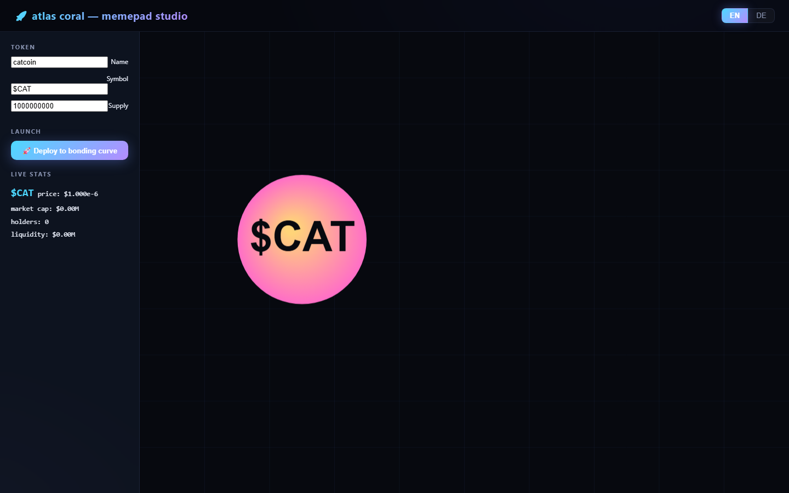
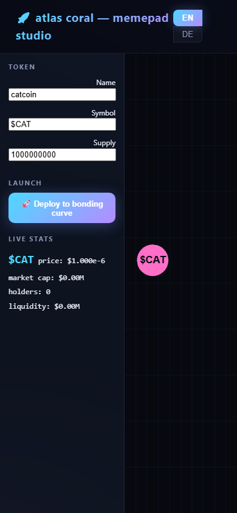

# Atlas Coral — Memepad Studio

A memecoin bonding-curve simulator: name your token, hit deploy and watch a live simulated price feed, market cap, holder growth and equity curve — meow energy included.

<div align="center">


**[Live Demo](https://ruslanfridenli.github.io/atlas-coral/)** · **[Deutsch ↓](#-deutsch)**

</div>

---

## Screenshots






## Features

- Bonding-curve price simulation with live feed
- Market cap, holder count and liquidity tracking
- Canvas equity curve with glow rendering
- Custom token name & symbol
- Persistent hype mechanics
- English/German interface

## Local development

```bash
git clone https://github.com/ruslanfridenli/atlas-coral.git
cd atlas-coral
# open index.html in a browser, or serve statically:
npx serve .
```

No build step, no dependencies — pure static site.

---

## 🇩🇪 Deutsch

### Atlas Coral — Memepad Studio

Ein Memecoin-Bonding-Curve-Simulator: Token benennen, deployen und Live-Kursfeed, Market Cap, Halterwachstum und Kurslinie beobachten — meow-Energie inklusive.

### Funktionen

- Bonding-Curve-Kurssimulation mit Live-Feed
- Market Cap, Halterzahl und Liquiditäts-Tracking
- Canvas-Kurslinie mit Glow
- Eigener Token-Name & -Symbol
- Persistente Hype-Mechanik
- Englische/deutsche Oberfläche

### Lokale Entwicklung

```bash
git clone https://github.com/ruslanfridenli/atlas-coral.git
cd atlas-coral
npx serve .
```

Reine statische Seite — kein Build-Schritt, keine Abhängigkeiten.

---

## ☕ Support / Unterstützen

Wenn dir diese Website beim Lernen hilft, würde mir eine Spende sehr viel bedeuten und dabei helfen, sie weiterzuentwickeln. Alternativ kannst du das Projekt mit einem Stern im github repo unterstützen. Vielen Dank!

- Solana: `zQpgZ6nGigww7vYpz3Qqxb1BT44kqS567vFaLTeHagS`
- Ethereum: `0x9c4fE1B2e9a1A9c22312c8296BB088Ca0e8F1B4e`
- Bitcoin: `bc1p2jltk9ya9kyzv35d8kxn7mmg9jqkx66cqtgzqwe75zlr4v9jk4hsv468q7`

---

Made with care. Feedback welcome via issues.
